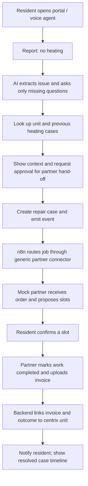

# Reltix / centrix — Hackathon Project Plan

**Project:** Context-Aware AI Maintenance Coordinator  
**Track:** Reltix — *Plug a Partner into centrix*  
**Event:** MAIN Summit AI Hackathon, Maastricht, 20–21 November 2026  
**Status:** Proposed implementation plan (not an official Reltix technical specification)  
**Primary use case:** Broken heater → craftsman → booked repair → completed repair → invoice linked to unit  
**Submission deadline:** Saturday 21 November, 10:30 (GMT+1) via BuilderBase *Hand in*: project name, code (the same version as in the demo) and a 3-minute pitch video. **Feature freeze: Saturday 06:00.** Target submit time: 10:00.

> **One-sentence pitch:** An AI property-service coordinator that does not merely create a ticket: it collects a tenant's issue, uses centrix property context, books a suitable craftsperson, tracks the work, and writes the outcome back to the property record.

## 0. Read this first — scope and source of truth

This plan is designed for a small team working within the hackathon window. **Implement one complete flow before adding extra features.** A narrow, reliable end-to-end demo is preferable to several partially functional service types.

### Shared context for three people and multiple AI tools

- `AGENTS.md` is the canonical repository working agreement and must be read before implementation changes.
- This plan is the canonical product and architecture proposal.
- `Reltix-Track-Description.pdf` is the official challenge source and wins if a proposed detail conflicts with it.
- Shared schemas, state names, events and example payloads are team contracts. Change them deliberately and update tests and documentation in the same commit.
- Each task should name the acceptance test or demo step it enables. Avoid parallel scaffolding that does not advance the vertical slice.

### What Reltix explicitly requires

The official **Reltix-Track-Description.pdf** (pp. 1–4) says to:

1. **Detect the moment** when a service is relevant to a resident or property.
2. **Hand over context** from centrix so the resident does not repeatedly enter information already known.
3. **Hold the conversation** through an appropriate channel, with minimal effort for everyone involved.
4. **Close the loop:** report the result and link the contract, appointment or invoice back to the unit/case.
5. Deliver **a working demo:** `centrix event → resident → partner → result on unit`.
6. Deliver **a reusable partner connector specification**, with service/offer descriptions, eligibility, availability, ordering and status updates.
7. Reach the resident directly through at least one channel; show how the partner receives a job and reports status back.

The track explicitly provides **no centrix API and no dataset**. We must make representative synthetic data, build our own lightweight centrix stand-in, and clearly disclose assumptions.

### Judging rubric (official)

| Criterion | Weight | What we must demonstrate |
|---|---:|---|
| Demo quality | **30%** | Trigger-to-outcome workflow visibly completes |
| User experience | **25%** | Very little effort for resident, partner and manager |
| Feasibility and realism | **20%** | Credible operational assumptions, privacy, appropriate approval/consent and partner workflow |
| Connector specification | **15%** | Next partner can plug in without architecture changes |
| Partner choice | **10%** | Clear reason for the partner, event and service |

**Practical implication:** 55% is demo + UX. Protect the end-to-end experience before polishing secondary features.

---

## 1. Product decision

### Chosen service: heating repair

**Trigger:** A resident reports that the heating in their apartment has stopped working.  
**Partner:** A simulated heating/repair contractor.  
**Resident channel:** Web portal with conversational text as the reliable baseline, ElevenLabs voice agent as enhancement.  
**Partner channel:** Lightweight partner dashboard or mock API.  
**Result:** A booked visit, completed repair report, and invoice linked to the original property/unit/case.

**Why this service?** It is easy to understand in a short demo, uses genuine property context (unit, heating system, repair history), allows a clear partner hand-off, and has an observable final outcome. The official brief gives *broken heater → craftsman* as one of its examples.

**Because it is an official example, other teams will likely build it too.** We differentiate on the parts most teams skip: a real *detect the moment* story beyond "tenant opens a chat", a closed loop that ends on the unit record, and a connector that visibly accepts a second provider without code changes in the case domain.

### How we cover the four official capabilities

| Official capability | What we deliver | Priority |
|---|---|---|
| 1. Detect the moment | A centrix event (`maintenance.case_created`) fires from the resident's portal/voice report. P1: building-wide detection, where two or more units in the same property reporting no heating within 24 h are linked to one central-heating job instead of duplicate call-outs, and all affected tenants are informed. P2: an inbound tenant email in the centrix inbox is classified into the same event. | P0 / P1 / P2 |
| 2. Hand over context | The unit snapshot (address, unit, heating type, building year, prior heating case, access details such as caretaker or key safe) is pre-filled into the partner job. The tenant only adds symptoms and availability. P1: optional photo upload, attached to the job; AI describes it, but never diagnoses. | P0 / P1 |
| 3. Hold the conversation | Portal chat (P0), ElevenLabs voice through the same backend tools (P1), cross-channel continuity (P1). Partner side: partner dashboard (P0). | P0 / P1 |
| 4. Close the loop | Appointment, completion report and invoice are linked to the case and unit. Tenant and manager are updated at every transition. P2: invoices above a cost threshold require manager approval before they are accepted. | P0 / P2 |

Trigger event, in the same shape as the brief's example payload:

```json
{
  "event": "maintenance.case_created",
  "occurred_at": "2026-11-20T18:02:00Z",
  "unit_id": "unit_4b",
  "contact_id": "c_202",
  "data": { "case_id": "case_001", "issue_type": "heating_repair", "channel": "portal_chat" }
}
```

### User stories

- **Tenant:** “I can say my heating is broken without re-entering my address, receive appropriate follow-up questions, approve the relevant data sharing, pick a slot, and see progress.”
- **Property manager:** “I can see the issue, what information was shared, which partner is assigned, the appointment, and the outcome in one case.”
- **Partner:** “I receive enough job context to act, propose availability, report status, and attach an invoice without email back-and-forth.”
- **Reltix integration owner:** “I can add another repair partner through the same connector contract.”

### Definition of done — the vertical slice

A tester can: **report broken heating → create a persistent case → share the necessary context → send a job via n8n → receive partner slots → confirm a slot → simulate repair completion → attach an invoice → see the final result in the tenant and manager views.** All statuses must derive from persisted backend records, not hard-coded visual progress.

---

## 2. Main demonstration flow



**Critical distinction:** A job is *not* complete when the AI says “I've booked it” or when the partner is contacted. The backend must receive an actual simulated partner acceptance and later a completion event before advancing states.

### Suggested state machine

```text
REPORTED
   ↓
TRIAGED
   ↓
AWAITING_SHARING_APPROVAL
   ↓
PARTNER_REQUESTED
   ↓
SLOTS_OFFERED
   ↓
SCHEDULED
   ↓
IN_PROGRESS
   ↓
COMPLETED
   ↓
CLOSED
```

Support explicit alternate branches: `DECLINED`, `NO_PROVIDER_AVAILABLE`, `CANCELLED`, `NEEDS_HUMAN_REVIEW`, `FAILED`. Do not allow arbitrary jumps. Persist every transition as an event with timestamp and actor.

### Example live demo script (2–3 minutes, target)

1. Begin on a seeded tenant's property page. It shows an apartment with gas central heating and an older repair case.
2. Type or say, “My heating has stopped working.”
3. Agent asks one or two follow-up questions; demonstrate that address and heating type were auto-filled.
4. Show partner hand-off details and approve sharing the minimum required information.
5. Submit; show n8n run and the job appearing in the contractor's dashboard.
6. Contractor offers two slots; tenant chooses one.
7. Contractor marks repair complete and uploads a demo invoice.
8. Switch to manager/unit view: show exact case, partner, appointment, invoice, tenant notification and event timeline.
9. Briefly show the connector interface and explain how a second contractor plugs in.

**Always have a typed-input fallback** for microphone issues or unreliable venue internet.

---

## 3. Architecture and ownership

### Proposed stack

| Layer | Technology | Ownership |
|---|---|---|
| Tenant portal + manager UI + partner UI | React + TypeScript (+ Tailwind if convenient) | Team frontend |
| Domain API and state machine | Python + FastAPI + Pydantic | Team backend |
| Persistence | SQLite for hackathon | Team backend |
| Conversational understanding | OpenAI structured extraction (or another available LLM) | AI integration |
| Resident voice | ElevenLabs conversational agent | AI/voice integration |
| Orchestration | n8n webhooks, HTTP Request, IF/Switch | Workflow integration |
| External service | Local/deployed **mock partner API** and dashboard | Workflow/backend |

### Responsibility split

- **FastAPI is the source of truth:** property data, tenants, authorization, cases, status transitions, appointments, documents and invoices.
- **n8n handles integration orchestration:** react to events, send jobs, process partner events, notify services and retry failures.
- **The LLM interprets language:** extract the problem and missing details, generate user-friendly responses. It must **not** fabricate bookings or directly force arbitrary status changes.
- **ElevenLabs provides a voice interface:** same backend tools and case model as the typed portal.
- **Partner connector abstracts providers:** a stable request/status interface, independent of the provider's API or dashboard.

### Deployment/network rule

If using n8n Cloud or hosted ElevenLabs webhooks, they cannot call a backend that is only reachable on a developer's `localhost`. Use a secured, reachable HTTPS deployment/tunnel for inbound calls, or run everything on one reachable host. Keep secrets out of the React app. Have a local deterministic demo fallback if a third-party service is unavailable.

---

## 4. Synthetic centrix data model

**The following are our proposed fields, not real reltix API definitions.** Use only fictional residents and properties.

| Entity | Minimum fields | Purpose |
|---|---|---|
| `Property` | id, address, building_year, heating_type | Partner context |
| `Unit` | id, property_id, floor, unit_label | Correct location |
| `Resident` | id, unit_id, name, preferred_contact, move_in | Who to update |
| `MaintenanceCase` | id, unit_id, resident_id, issue_type, description, priority, status, partner_id | Core state |
| `CaseEvent` | id, case_id, type, actor, timestamp, payload | Audit/event timeline |
| `Partner` | id, name, service_types, region, availability, endpoint | Partner selection |
| `Appointment` | id, case_id, partner_id, start_time, end_time, status | Booking |
| `Document` | id, case_id, kind, filename, url/path, created_at | Invoice and repair report |
| `SharingApproval` | id, case_id, shared_fields, recorded_at, channel, approved_by | Traceable hand-off |

Seed one property and unit based on **fictional examples** similar to the Reltix brief, plus 2–3 maintenance cases and 2 partner records (only one needs to be fully integrated). Include at least one **previous heating-related case** so the demo can show contextual awareness.

### Example issue-extraction schema

```json
{
  "case_id": "case_001",
  "unit_id": "unit_4b",
  "issue_type": "heating_repair",
  "description": "No heat since last night",
  "symptoms": ["radiators_cold"],
  "urgency": "high",
  "availability_preferences": ["weekday_morning"],
  "missing_information": ["is_hot_water_working"],
  "source_channel": "portal_chat"
}
```

**Guardrails:** AI extraction is tentative. The backend validates allowed categories and required fields. AI may use prior repair history to offer relevant context but must not claim a diagnosis or guarantee a technician's arrival.

---

## 5. Minimum API contract (proposed)

### centrix stand-in (FastAPI)

| Method | Route | Behavior |
|---|---|---|
| `GET` | `/api/units/{unit_id}/context` | Authorized snapshot of property, resident, heating, prior issues |
| `POST` | `/api/cases/extract` | LLM returns validated issue interpretation and missing fields |
| `POST` | `/api/cases` | Create case and emit `maintenance.case_created` event |
| `GET` | `/api/cases/{case_id}` | Case, appointment, document and status |
| `GET` | `/api/cases/{case_id}/events` | Ordered timeline |
| `POST` | `/api/cases/{case_id}/sharing-approval` | Log approved fields and trigger hand-off |
| `POST` | `/api/cases/{case_id}/select-slot` | Validate offered slot, confirm booking |
| `POST` | `/api/integrations/partner-events` | Validate signed/idempotent partner callback |
| `GET` | `/api/units/{unit_id}/cases` | Show property history |

### Generic partner connector (version 1)

| Operation | Meaning |
|---|---|
| `GET /connector/capabilities` | Supported service types, geographic coverage, required fields |
| `POST /connector/jobs` | Create or reuse a job for a case |
| `GET /connector/jobs/{job_id}` | Retrieve current state |
| `GET /connector/jobs/{job_id}/slots` | Return available appointment slots |
| `POST /connector/jobs/{job_id}/book` | Book selected slot |
| `POST /connector/jobs/{job_id}/cancel` | Cancel job safely |
| Partner → centrix callback | Send `accepted`, `slots_offered`, `scheduled`, `in_progress`, `completed`, `invoice_ready`, `failed` events |

### Example partner order

```json
{
  "schema_version": "1.0",
  "request_id": "case_001",
  "idempotency_key": "case_001-heating-v1",
  "service_type": "heating_repair",
  "property": {
    "address": "Musterstraße 12, 52062 Aachen",
    "unit": "4B",
    "heating_type": "gas central heating"
  },
  "issue": {
    "description": "No heat since last night",
    "priority": "high"
  },
  "resident": {
    "name": "Lena Hoffmann",
    "contact": "lena@example.com"
  },
  "sharing": {
    "approved_fields": ["name", "contact", "address", "unit", "issue"],
    "approved_at": "2026-11-20T14:00:00Z"
  },
  "callback_url": "https://demo.example/api/integrations/partner-events"
}
```

The payload is illustrative. **Minimize data sharing:** do not send the resident's unrelated documents, lease terms, other residents' information, or full maintenance history by default. Only send relevant history when justified and clearly disclosed.

### Connector design requirements

- **Provider-neutral:** Different repair companies implement the same semantic operations; provider-specific payload differences remain inside the adapter.
- **Idempotent:** Retrying a submission does not create a second job. Repeated callbacks do not create duplicate case events or documents.
- **Auditable:** Every outbound request, approval and inbound result is associated with the original case ID.
- **Authenticated:** Shared secret or signed webhook for demo; verify provider identity before accepting state changes.
- **Resilient:** Timeouts, failed bookings and partner rejection are visible, with a human escalation path.
- **Versioned:** Specify schema version, required and optional fields, event types and error codes.
- **Extensible:** Document what would change to support an internet or energy partner later, without actually implementing a second service flow.

---

## 6. AI behavior, ranking and orchestration

### A. Structured issue extraction

**Input:** resident's words + authorized unit context.  
**Output:** valid JSON with issue category, symptoms, urgency, missing fields and a suggested next question.  
**Approach:** LLM structured output / schema validation. Ask no more than the minimum questions needed to proceed. If confidence is low, ask the resident rather than guessing.

### B. Context-aware enrichment (our proposed differentiator)

If a previous heating case exists, append a clearly marked note such as:

> Previous maintenance record: a heating-pressure issue was logged 14 days ago. Current fault is not diagnosed; partner should check whether it is related.

Show the data source in the manager view. Do not tell the tenant that the earlier problem is definitely the cause.

### C. Partner matching

For the MVP, use **deterministic rules**, not a complex learned recommender:

1. Filter by supported service category (`heating_repair`).
2. Filter by serviced location/region.
3. Filter by capacity/available slots.
4. Rank by earliest available slot, with cost or priority as a tie-breaker.
5. Escalate when no provider qualifies.

A possible transparent scoring heuristic (only among eligible providers) is:

`match_score = 0.65 * availability_score + 0.20 * distance_score + 0.15 * price_score`

These weights are **our proposal**, not an official Reltix algorithm. For one partner, use the same routing interface so the architecture is demonstrably extensible.

### D. AI and voice safety boundaries

- AI can ask questions and explain the current state, **not invent a status**.
- Only the backend may approve state transitions.
- Voice agent invokes authenticated tools (`get_unit_context`, `create_case`, `get_case_status`, `confirm_slot`).
- Explicit user confirmation for booking and for any relevant personal-data handoff; keep a recorded audit entry.
- Urgent safety statements (e.g., suspected gas leak) should show a predetermined emergency escalation message, not attempt a conversational diagnosis.

### E. n8n workflows

**Workflow 1: Case submitted**

```text
Webhook: maintenance.case_created / sharing-approved
  → Validate event + idempotency key
  → HTTP Request: GET case context from FastAPI
  → HTTP Request: POST job to generic partner connector
  → HTTP Request: update/acknowledge integration state in FastAPI
  → Notify resident that request was submitted (not yet completed)
```

**Workflow 2: Partner responds**

```text
Webhook: signed partner event
  → Validate signature + event ID
  → Switch on event type
  → HTTP Request: apply valid transition in FastAPI
  → Notify tenant of slots, appointment or completion
  → Ensure invoice/report document is linked to original case
```

Keep all sensitive tokens in n8n credentials/environment secrets. Avoid hard-coded API keys and resident data in workflow definitions committed to Git.

---

## 7. UI screens — only what is needed

### Screen A — Tenant portal (P0)

- Unit and resident context already selected for demo.
- Chat-like issue entry, single primary action; no long form.
- AI asks only missing questions and displays an editable confirmation summary.
- Clear notice of partner and fields being shared; approval step.
- Appointment choices and confirmation.
- Real case timeline, status and completion notification.

### Screen B — Partner dashboard (P0)

- Incoming jobs queue with relevant property/issue context.
- Accept/reject job and provide slots.
- Mark job in progress, then complete.
- Attach invoice or simulated invoice record.

### Screen C — centrix manager / unit view (P0)

- Unit details, existing cases, case history and communications.
- Current service partner, status history, appointment and invoice attachment.
- Evidence of what tenant approved for partner sharing.

### Screen D — ElevenLabs voice (P1)

- Start a conversation with the same tenant context.
- Collect a report and call the same backend tools used by typed input.
- If voice fails, allow an immediate transition to typing without losing the case.

**Do not prioritize:** complex analytics, payment processing, full landlord administration, authentication for many organizations, fancy map views, dozens of service types, real contractor marketplaces.

---

## 8. Implementation backlog

### P0 — must be working for a competitive submission

- [ ] Set up repository, development commands, environment variables and shared API contracts.
- [ ] Create synthetic property/unit/resident/history records in SQLite.
- [ ] Define case state machine and immutable case-event history.
- [ ] Implement FastAPI case CRUD and required actions.
- [ ] Build resident text/chat flow with minimal questions.
- [ ] Add issue extraction with strict JSON validation; provide deterministic fallback.
- [ ] Build sharing/approval screen and store approval record.
- [ ] Implement generic partner adapter and one mock heating contractor.
- [ ] Build basic partner dashboard with booking and completion controls.
- [ ] Connect n8n workflow to the backend and partner API.
- [ ] Persist appointment, completion report and invoice on the same case/unit.
- [ ] Build manager/unit case timeline.
- [ ] Write connector specification including schema, auth, idempotency, events and errors.
- [ ] Run and record end-to-end demo with the actual running stack.

### P1 — high-value differentiation, only after P0 works

- [ ] ElevenLabs conversational voice reporting via backend tools.
- [ ] Context-aware previous-repair reference with source attribution.
- [ ] Cross-channel continuity: voice conversation continues in portal.
- [ ] One failure branch: partner rejects or has no available slots, then graceful escalation.
- [ ] Demonstrate second simulated repair provider using the same connector contract. Adding it should require only a provider registration (capabilities, region, endpoint) and an adapter, with no change to case-domain code. Show this in the video.
- [ ] Building-wide outage detection: deterministic rule (≥2 units, same property, `heating_repair`, within 24 h) links cases to one partner job and notifies all affected tenants.
- [ ] Access details and photos in the partner job (caretaker/key-safe info from seed data; optional photo upload).

### P2 — explicitly optional

- [ ] Additional service category (internet, energy, etc.).
- [ ] Resident messaging/email integration beyond on-screen notifications.
- [ ] Smarter multi-provider optimization or cost comparison.
- [ ] Operational dashboard and analytics.

---

## 9. Team responsibilities and delivery sequence

This project has **three contributors**. Use the ownership split below to reduce overlap while keeping every contributor accountable for an end-to-end integration boundary.

| Owner | Main responsibility | Initial deliverable | Integration boundary |
|---|---|---|---|
| A — Product / Frontend | Tenant, manager and partner views; demo UX; pitch flow | UI skeleton wired to agreed example payloads | Consumes backend contracts; owns the repeatable demo path |
| B — Backend / Domain | FastAPI, SQLite, models, case state machine, seed data, tests | Persistent case API and immutable event timeline | Publishes validated case and context contracts |
| C — AI / Integrations | Structured extraction, mock partner connector, n8n, optional ElevenLabs | Partner receives exactly one job and can send a validated event | Uses backend transitions; owns external fallbacks and connector docs |

All three contributors review shared contract changes. Owner A can build against fixtures while Owner B stabilizes the API; Owner C can build the connector against the same fixtures. Replace fixtures with live calls as soon as the contract endpoint exists.

### Git and AI collaboration protocol

1. Pull before starting and inspect open changes before editing shared files.
2. Use short-lived branches named for the owned slice, for example `frontend/tenant-flow`, `backend/case-state`, or `integration/mock-partner`.
3. Keep pull requests small and state the acceptance test or demo step they unlock.
4. Do not let an AI tool silently rename endpoints, states or fields. Contract changes require an explicit review from the affected owner.
5. Rebase or merge `main` frequently during the event; resolve schema conflicts together rather than creating compatibility shims.
6. Tag a known-good demo commit before adding P1 features.

### Schedule to the deadline (Friday 15:30 → Saturday 10:30)

The team works through the night with staggered naps. Owners follow the table above: **A** = Product/Frontend, **B** = Backend/Domain, **C** = AI/Integrations.

| Time | A — Frontend | B — Backend | C — AI / Integrations | Exit check |
|---|---|---|---|---|
| Fri 15:30–16:00 | Freeze contracts together: case, unit context, connector job, partner callback; commit shared example JSON | (together) | (together) | Everyone builds against the same fixtures |
| 16:00–18:00 | Tenant portal and partner dashboard skeletons on fixtures | Schema, seed data, case API, event timeline, state-machine tests | Mock partner API. **Risk checks:** ElevenLabs agent calls a backend tool through a public tunnel URL; n8n reaches the backend | **18:00:** case persists across restart; voice go/no-go decided |
| 18:00–19:00 | Sharing-approval screen | Sharing approval, connector `POST /jobs`, idempotency | n8n Workflow 1 (case submitted) | **Team milestone:** partner receives exactly one job |
| 19:00–19:45 | Dinner | | | |
| 19:45–23:30 | Slot selection, manager/unit view | Slots, booking, callbacks, invoice document, signature check | LLM extraction with deterministic fallback; n8n Workflow 2 (partner responds) | |
| **23:30–00:00** | **Checkpoint: full typed flow end to end. Tag `demo-p0`.** If not working, cut P1 and fix. | | | |
| 00:00–03:00 | Timeline polish, failure-state UI | Failure branch, building-wide detection rule | ElevenLabs voice on the same backend tools | Naps: A 01:00–02:15, C 02:15–03:30 |
| 03:00–06:00 | UX polish, realistic demo data | Second provider through the connector, tests | `connector-spec.md`, `assumptions.md`, pitch script | Nap: B 03:30–04:45 |
| **Sat 06:00** | **Feature freeze. Tag `demo-final`. Bug fixes only after this point.** | | | |
| 06:00–08:00 | Record demo footage and voiceover | | | |
| 08:00–09:30 | Edit the 3-minute video; README startup commands; confirm the pushed code equals `demo-final` | | | |
| **09:30–10:00** | **Submit on BuilderBase.** 10:00–10:30 is buffer only. | | | |

### 3-minute video outline

1. **0:00–0:15** Problem: a broken heater takes a dozen calls and emails.
2. **0:15–1:45** The flow: report (voice or chat) → context pre-filled → approval → partner receives job → slot booked → completion and invoice → unit view and timeline.
3. **1:45–2:15** One differentiator that is stable at freeze: building-wide detection or the failure/escalation branch.
4. **2:15–2:40** Connector spec, and the second provider plugged in without changing case logic.
5. **2:40–3:00** Why heating repair, measurable value, what is simulated.

### Suggested repo layout

```text
reltix-hackathon/
  frontend/              # React tenant, manager, partner UIs
  backend/
    app/
      api/               # FastAPI routes
      models/            # DB entities and schemas
      services/          # case transitions, routing, context lookup
      integrations/      # generic provider adapter, ElevenLabs tools
    tests/
    seed_data/
  n8n/                   # exportable workflows (without credentials)
  Docs/
    connector-spec.md
    demo-script.md
    assumptions.md
  .env.example
  README.md
```

---

## 10. Acceptance tests and evaluation

### Mandatory functional tests

| Test | Expected result |
|---|---|
| Report heater issue | A case appears with correct unit/resident association |
| Restart backend | Case and event timeline persist |
| AI misses a required detail | Agent asks for it rather than inventing an answer |
| Approve partner handoff | Recorded approval lists actual fields shared |
| Submit job through n8n | Partner receives exactly one job with same case ID |
| Retry submission | No duplicate job is created |
| Offer and select slot | Appointment is persisted and visible in tenant + partner views |
| Mark repair completed | Correct case transitions to `COMPLETED` |
| Upload invoice | Invoice is linked to the case and unit |
| Duplicate partner callback | No duplicate event or invoice |
| Invalid callback signature | Event is rejected, no case changes |
| Provider unavailable | Clear human escalation/failure state |
| Voice unavailable | Typed workflow still works end to end |

### Qualitative evaluation against the rubric

- **Demo (30%):** An observer sees a real chain of persisted events ending in a linked repair outcome.
- **UX (25%):** Resident types/says the problem; known information is auto-filled; only necessary approvals are requested.
- **Realism (20%):** Partner actually receives structured data, can respond, and there is an audit trail and minimal data sharing.
- **Connector (15%):** No provider-specific assumptions leak into case logic; schema and callback semantics are documented.
- **Partner (10%):** Heating repair is a clear, urgent moment with tangible value to tenant and manager.

---

## 11. Risks, mitigations and honest demo boundaries

| Risk | Mitigation |
|---|---|
| ElevenLabs or microphone fails live | Maintain complete typed chat path |
| Hosted n8n cannot reach local backend | Deploy securely or use a temporary HTTPS tunnel; test early |
| LLM hallucinates a repair diagnosis or booking | Validate structured output, use backend truth, show unknown status |
| Partner response never arrives | Mock dashboard can emit deterministic callback; show timeout handling |
| Overbuilding features | Strict P0/P1 boundary; no second service until full first flow works |
| Privacy concerns | Synthetic data, least-privilege sharing, recorded approval and clear assumptions |
| Demo only looks functional | Ensure persisted records and real API calls; do not fake UI status changes |

**Explicit claims to avoid:** “Connected to the real centrix API,” “Booked with a real contractor,” “Repair has happened in the real world,” or “GDPR compliant by default.” State that the integration is a **simulation based on Reltix's brief** and describe what would be necessary to productionize it.

---

## 12. Final hand-in package

- [ ] Runnable prototype and startup instructions (`README.md`).
- [ ] One reliable, repeatable live demo (resident → partner → resolved unit case).
- [ ] Exported n8n workflows with safe configuration instructions.
- [ ] `Docs/connector-spec.md` with endpoints, schemas, auth, retries, events and errors.
- [ ] `Docs/assumptions.md` explaining synthetic data and simulated endpoints.
- [ ] BuilderBase hand-in: project name, code (same version as in the demo, tagged `demo-final`) and a 3-minute pitch video. Submit by 10:00; hard deadline 10:30 (GMT+1).
- [ ] A small test suite or test evidence for the happy path and major edge cases.
- [ ] Pitch covering problem, why heating repairs, approach, architecture, UX and measurable value.

### Suggested pitch structure

1. **Problem:** Repairs require fragmented emails and calls; centrix already knows the property context.
2. **Product:** A zero-form maintenance coordination flow rather than a chatbot-only ticket creator.
3. **Live demonstration:** Tenant reports → contractor accepts → slot booked → work completed → invoice on the unit.
4. **Differentiation:** Context-aware, minimal effort, closed-loop orchestration and provider-neutral connectors.
5. **Feasibility:** Clear demo assumptions, consent/approval, auditable statuses and next integration steps.

### Next steps (as of Friday 15:30)

1. Agree on **broken heater → repair partner** as the only required service flow, and pick the project name (required for submission).
2. Freeze `/api/cases`, `/api/units/{unit_id}/context`, partner `POST /jobs`, and the callback contract; commit shared example JSON.
3. Collect API access: OpenAI key (BuilderBase → Resources → Reveal), ElevenLabs key (via Discord), n8n link (file in BuilderBase Resources). Document variable names in `.env.example`; never commit values.
4. Before 18:00, test the two network risks: ElevenLabs tool call and n8n webhook each reaching the backend through a public HTTPS tunnel.
5. Seed one tenant/unit, one historical heating case, access details and one contractor.
6. Implement the first vertical slice: **create persistent case → mock partner receives job**.

---

## 13. Sources and provenance

**Primary, official materials provided by the team:**

- `Reltix-Track-Description.pdf` — pp. 1–2: business problem, four capabilities, broken-heater example, channels and partner-side expectation; pp. 3–4: centrix example payloads, connector deliverable, judging rubric and prize.

**Proposed by our team / this planning document, not official requirements:** named product concept, selected technology stack, database schema, endpoint paths, scoring weights, state names, UI layout, task ownership, estimates, test cases and sample payloads.

*Document purpose: a human-readable project plan and AI-coding-agent-ready implementation brief. Use the official Reltix brief to resolve any conflict.*
