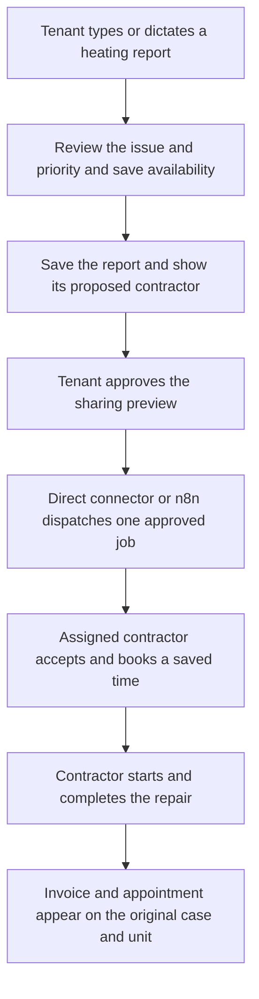

# Reltix / centrix — Hackathon Project Plan

**Project:** Context-Aware AI Maintenance Coordinator  
**Track:** Reltix — *Plug a Partner into centrix*  
**Event:** MAIN Summit AI Hackathon, Maastricht, 20–21 November 2026  
**Status:** Product plan with current implementation and release checklist\
**Primary use case:** Broken heater → craftsman → booked repair → completed repair → invoice linked to unit  
**Submission deadline:** Saturday 21 November, 10:30 (GMT+1) via BuilderBase *Hand in*: project name, code (the same version as in the demo) and a 3-minute pitch video. **Feature freeze: Saturday 06:00.** Target submit time: 10:00.

> **One-sentence pitch:** An AI property-service coordinator that does not merely create a ticket: it collects a tenant's issue, uses centrix property context, books a suitable craftsperson, tracks the work, and writes the outcome back to the property record.

## 0. Read this first — scope and source of truth

This plan is designed for a small team working within the hackathon window. **Implement one complete flow before adding extra features.** A narrow, reliable end-to-end demo is preferable to several partially functional service types.

### Shared context for three people and multiple AI tools

- `AGENTS.md` is the canonical repository working agreement and must be read before implementation changes.
- This plan is the canonical product and architecture proposal.
- `Reltix-Track-Description.pdf` is the official challenge source and wins if a proposed detail conflicts with it.
- Shared schemas, state names, events and example payloads are team contracts. Change them deliberately and update tests and documentation in the same commit.
- Each task should name the acceptance test or demo step it enables. Avoid parallel scaffolding that does not advance the vertical slice.

### What Reltix explicitly requires

The official **Reltix-Track-Description.pdf** (pp. 1–4) says to:

1. **Detect the moment** when a service is relevant to a resident or property.
2. **Hand over context** from centrix so the resident does not repeatedly enter information already known.
3. **Hold the conversation** through an appropriate channel, with minimal effort for everyone involved.
4. **Close the loop:** report the result and link the contract, appointment or invoice back to the unit/case.
5. Deliver **a working demo:** `centrix event → resident → partner → result on unit`.
6. Deliver **a reusable partner connector specification**, with service/offer descriptions, eligibility, availability, ordering and status updates.
7. Reach the resident directly through at least one channel; show how the partner receives a job and reports status back.

The track explicitly provides **no centrix API and no dataset**. We must make representative synthetic data, build our own lightweight centrix stand-in, and clearly disclose assumptions.

### Judging rubric (official)

| Criterion | Weight | What we must demonstrate |
|---|---:|---|
| Demo quality | **30%** | Trigger-to-outcome workflow visibly completes |
| User experience | **25%** | Very little effort for resident, partner and manager |
| Feasibility and realism | **20%** | Credible operational assumptions, privacy, appropriate approval/consent and partner workflow |
| Connector specification | **15%** | Next partner can plug in without architecture changes |
| Partner choice | **10%** | Clear reason for the partner, event and service |

**Practical implication:** 55% is demo + UX. Protect the end-to-end experience before polishing secondary features.

---

## 1. Product decision

### Chosen service: heating repair

**Trigger:** A resident reports that the heating in their apartment has stopped working.  
**Partner:** A simulated heating/repair contractor.  
**Resident channel:** The portal supports typed reports and optional dictation. The simulated outbox and optional email and text transports can link residents back to My cases. A one-click booking link is planned. The project keeps the phone-agent scope described in [mentor feedback](mentor-feedback.md).\
**Partner channel:** Lightweight partner dashboard or mock API.  
**Result:** A booked visit, completed repair report, and invoice linked to the original property/unit/case.

**Why this service?** It is easy to understand in a short demo, uses genuine property context (unit, heating system, repair history), allows a clear partner hand-off, and has an observable final outcome. The official brief gives *broken heater → craftsman* as one of its examples.

**Because it is an official example, other teams will likely build it too.** We differentiate on the parts most teams skip: a real *detect the moment* story beyond "tenant opens a chat", a closed loop that ends on the unit record, and a connector that visibly accepts a second provider without code changes in the case domain.

### How we cover the four official capabilities

| Official capability | What we deliver | Priority |
|---|---|---|
| 1. Detect the moment | A centrix event (`maintenance.case_created`) fires when the tenant saves a portal report. P1 (mentor-confirmed as realistic): building-wide detection, where two or more units in the same property reporting no heating within 24 h are linked to one central-heating job instead of duplicate call-outs, and all affected tenants are informed. P2: an inbound tenant email in the centrix inbox is classified into the same event. | P0 / P1 / P2 |
| 2. Hand over context | The portal pre-fills address, unit and known heating type and shares fields covered by consent. The connector can carry approved prior repair and access context. Photo upload remains optional backlog work. | P0 / P1 |
| 3. Hold the conversation | The resident uses the portal, optionally with dictation. The contractor uses its own dashboard and sees only its approved jobs. Optional notification transports can link back to My cases. | P0 / P1 |
| 4. Close the loop | Appointment, completion report and invoice are linked to the case and unit. Tenant and manager are updated at every transition. P1: centrix approves repair costs up to €3,000; invoices above €3,000 are flagged for manager approval instead of closing silently. | P0 / P1 |

Trigger event, in the same shape as the brief's example payload:

```json
{
  "event": "maintenance.case_created",
  "occurred_at": "2026-11-20T18:02:00Z",
  "unit_id": "unit_4b",
  "contact_id": "c_202",
  "data": { "case_id": "case_001", "issue_type": "heating_repair", "channel": "portal_chat" }
}
```

### User stories

- **Tenant:** “I can say my heating is broken without re-entering my address, receive appropriate follow-up questions, approve the relevant data sharing, pick a slot, and see progress.”
- **Property manager:** “I can see the issue, what information was shared, which partner is assigned, the appointment, and the outcome in one case.”
- **Partner:** “I receive enough job context to act, propose availability, report status, and attach an invoice without email back-and-forth.”
- **Reltix integration owner:** “I can add another repair partner through the same connector contract.”

### Definition of done — the vertical slice

A tester can **report broken heating → review priority and save availability → approve sharing with the named contractor → confirm the contractor received one job → book a tenant slot → complete the repair and attach an invoice → see the outcome on the original unit**. Dispatch can use the provider-neutral n8n workflow or direct connector calls. All statuses must derive from persisted backend records, not hard-coded visual progress.

---

## 2. Main demonstration flow



A repair outcome appears only after FastAPI persists the corresponding booking, completion or invoice action. If no saved time is available to book, the tenant can update availability in My cases and the contractor can refresh.

### Suggested state machine

```text
REPORTED
   ↓
TRIAGED
   ↓
AWAITING_SHARING_APPROVAL
   ↓
PARTNER_REQUESTED
   ↓
SCHEDULED
   ↓
IN_PROGRESS
   ↓
COMPLETED
   ↓
CLOSED
```

The contractor-offer path passes through `SLOTS_OFFERED` before `SCHEDULED`. Support explicit alternate branches: `DECLINED`, `NO_PROVIDER_AVAILABLE`, `CANCELLED`, `NEEDS_HUMAN_REVIEW`, `FAILED`. Do not allow arbitrary jumps. Persist every transition as an event with timestamp and actor.

### Recording the live demo

Follow the [three-minute script](demo-script.md) with one test case. Rehearse typed intake and direct dispatch first. Show optional integrations only after verifying the same repair on the chosen demo configuration.

---

## 3. Architecture and ownership

### Proposed stack

| Layer | Technology | Ownership |
|---|---|---|
| Tenant portal + manager UI + partner UI | React + TypeScript (+ Tailwind if convenient) | Team frontend |
| Domain API and state machine | Python + FastAPI + Pydantic | Team backend |
| Persistence | SQLite for hackathon | Team backend |
| Conversational understanding | OpenAI structured extraction (or another available LLM) | AI integration |
| Resident messaging | Simulated SMS/email outbox with one-click links (no real sending) | AI/Integrations |
| Orchestration | n8n webhooks, HTTP Request, IF/Switch | Workflow integration |
| External service | Local/deployed **mock partner API** and dashboard | Workflow/backend |

### Responsibility split

- **FastAPI is the source of truth:** property data, tenants, authorization, cases, status transitions, appointments, documents and invoices.
- **n8n handles integration orchestration:** react to events, send jobs, process partner events, notify services and retry failures.
- **The LLM interprets language:** extract the problem and missing details, generate user-friendly responses. It must **not** fabricate bookings or directly force arbitrary status changes.
- **Text-message channel:** outbound messages are persisted in an outbox and link back to the same case; one-click actions call the same backend endpoints as the portal.
- **Partner connector abstracts providers:** a stable request/status interface, independent of the provider's API or dashboard.

### Deployment/network rule

If using n8n Cloud, it cannot call a backend that is only reachable on a developer's `localhost`. Use a secured, reachable HTTPS deployment/tunnel for inbound calls, or run everything on one reachable host. Keep secrets out of the React app. Have a local deterministic demo fallback if a third-party service is unavailable.

---

## 4. Synthetic centrix data model

**The following are our proposed fields, not real reltix API definitions.** Use only fictional residents and properties.

| Entity | Minimum fields | Purpose |
|---|---|---|
| `Property` | id, address, building_year, heating_type | Partner context |
| `Unit` | id, property_id, floor, unit_label | Correct location |
| `Resident` | id, unit_id, name, preferred_contact, move_in | Who to update |
| `MaintenanceCase` | id, unit_id, resident_id, issue_type, description, priority, status, partner_id | Core state |
| `CaseEvent` | id, case_id, type, actor, timestamp, payload | Audit/event timeline |
| `Partner` | id, name, service_types, region, availability, endpoint | Partner selection |
| `Appointment` | id, case_id, partner_id, start_time, end_time, status | Booking |
| `Document` | id, case_id, kind, filename, url/path, created_at | Invoice and repair report |
| `SharingApproval` | id, case_id, shared_fields, recorded_at, channel, approved_by | Traceable hand-off |

Seed one property and unit based on **fictional examples** similar to the Reltix brief, plus 2–3 maintenance cases and 2 partner records (only one needs to be fully integrated). Include at least one **previous heating-related case** so the demo can show contextual awareness.

### Example issue-extraction schema

```json
{
  "case_id": "case_001",
  "unit_id": "unit_4b",
  "issue_type": "heating_repair",
  "description": "No heat since last night",
  "symptoms": ["radiators_cold"],
  "urgency": "high",
  "availability_preferences": ["weekday_morning"],
  "missing_information": ["is_hot_water_working"],
  "source_channel": "portal_chat"
}
```

**Guardrails:** AI extraction is tentative. The backend validates allowed categories and required fields. AI may use prior repair history to offer relevant context but must not claim a diagnosis or guarantee a technician's arrival.

---

## 5. Minimum API contract (proposed)

### centrix stand-in (FastAPI)

| Method | Route | Behavior |
|---|---|---|
| `GET` | `/api/units/{unit_id}/context` | Authorized snapshot of property, resident, heating, prior issues |
| `POST` | `/api/cases/extract` | LLM returns validated issue interpretation and missing fields |
| `POST` | `/api/cases` | Create case and emit `maintenance.case_created` event |
| `GET` | `/api/cases/{case_id}` | Case, appointment, document and status |
| `GET` | `/api/cases/{case_id}/events` | Ordered timeline |
| `POST` | `/api/cases/{case_id}/sharing-approval` | Log approved fields and trigger hand-off |
| `POST` | `/api/cases/{case_id}/select-slot` | Validate offered slot, confirm booking |
| `POST` | `/api/integrations/partner-events` | Validate signed/idempotent partner callback |
| `GET` | `/api/units/{unit_id}/cases` | Show property history |

### Generic partner connector (version 1)

| Operation | Meaning |
|---|---|
| `GET /connector/capabilities` | Supported service types, geographic coverage, required fields |
| `POST /connector/jobs` | Create or reuse a job for a case |
| `GET /connector/jobs/{job_id}` | Retrieve current state |
| `GET /connector/jobs/{job_id}/slots` | Return available appointment slots |
| `POST /connector/jobs/{job_id}/book` | Book selected slot |
| `POST /connector/jobs/{job_id}/cancel` | Cancel job safely |
| Partner → centrix callback | Send `accepted`, `slots_offered`, `scheduled`, `in_progress`, `completed`, `invoice_ready`, `failed` events |

### Example partner order

```json
{
  "schema_version": "1.0",
  "request_id": "case_001",
  "idempotency_key": "case_001-heating-v1",
  "service_type": "heating_repair",
  "property": {
    "address": "Musterstraße 12, 52062 Aachen",
    "unit": "4B",
    "heating_type": "gas central heating"
  },
  "issue": {
    "description": "No heat since last night",
    "priority": "high"
  },
  "resident": {
    "name": "Lena Hoffmann",
    "contact": "lena@example.com"
  },
  "sharing": {
    "approved_fields": ["name", "contact", "address", "unit", "issue"],
    "approved_at": "2026-11-20T14:00:00Z"
  },
  "callback_url": "https://demo.example/api/integrations/partner-events"
}
```

The payload is illustrative. **Minimize data sharing:** do not send the resident's unrelated documents, lease terms, other residents' information, or full maintenance history by default. Only send relevant history when justified and clearly disclosed.

### Connector design requirements

- **Provider-neutral:** Different repair companies implement the same semantic operations; provider-specific payload differences remain inside the adapter.
- **Idempotent:** Retrying a submission does not create a second job. Repeated callbacks do not create duplicate case events or documents.
- **Auditable:** Every outbound request, approval and inbound result is associated with the original case ID.
- **Authenticated:** Shared secret or signed webhook for demo; verify provider identity before accepting state changes.
- **Resilient:** Timeouts, failed bookings and partner rejection are visible, with a human escalation path.
- **Versioned:** Specify schema version, required and optional fields, event types and error codes.
- **Cross-category:** Reltix must be able to add an internet partner at a moment's notice (mentor). The spec covers partners that *deliver* a service (jobs, slots, completion, invoice) and partners that *sell* one (offers, contract signed), with the internet move-in flow as the worked example.

---

## 6. AI behavior, ranking and orchestration

### A. Structured issue extraction

**Input:** resident's words + authorized unit context.  
**Output:** valid JSON with issue category, symptoms, urgency, missing fields and a suggested next question.  
**Approach:** LLM structured output / schema validation. Ask no more than the minimum questions needed to proceed. If confidence is low, ask the resident rather than guessing.

### B. Context-aware enrichment (our proposed differentiator)

If a previous heating case exists, append a clearly marked note such as:

> Previous maintenance record: a heating-pressure issue was logged 14 days ago. Current fault is not diagnosed; partner should check whether it is related.

Show the data source in the manager view. Do not tell the tenant that the earlier problem is definitely the cause.

### C. Partner matching

Eligible providers are active, registered delivery contractors for the case category and trigger. Heating repairs try contractors in the repair city first, then an available contractor in another city in the same country using a stable random order per case.

Availability checks the tenant's saved time windows against existing bookings. FastAPI rechecks the named recipient before approval. When no provider qualifies, the report stays saved and the tenant can check again later. See [contractor matching](connector-spec.md#contractor-matching).

### D. AI safety boundaries

- AI can ask questions and explain the current state, **not invent a status**.
- Only the backend may approve state transitions.
- Any agent (including Reltix's existing voice agent) uses the same authenticated endpoints (`get_unit_context`, `create_case`, `get_case_status`, `confirm_slot`); we do not build a voice agent.
- Explicit user confirmation for booking and for any relevant personal-data handoff; keep a recorded audit entry.
- Urgent safety statements (e.g., suspected gas leak) should show a predetermined emergency escalation message, not attempt a conversational diagnosis.

### E. n8n workflows

The provider-neutral workflow receives `maintenance.sharing_approved` and a case ID. It validates the event and calls the authenticated FastAPI dispatch gateway. FastAPI reads the saved order and consent, dispatches to the selected contractor and returns the job ID and duplicate flag. The optional legacy workflow sends an approved order to the HeatFix adapter. Partner timeline callbacks go directly to FastAPI.

Keep credentials in n8n or the backend environment. See the [workflow setup](../n8n/README.md) for direct dispatch and local rehearsal.

---

## 7. UI screens

| View | Implemented workflow |
|---|---|
| Tenant Report | Describe, Summary and Approve. Enter text or review a dictated transcript, edit the issue and priority, save at least one future slot, and approve sharing with the named contractor. Edit saved profile and home details in place. |
| Tenant My cases | View status, local appointment time, milestones, repair result and downloadable invoice. Update availability while awaiting booking. The bell shows contractor acceptance, decline and completion. |
| Contractor inbox | Switch providers by name in the header. Review the approved job, accept or decline, book one of the tenant’s saved times, then start work, complete the repair and attach the demo invoice. The bell shows the selected provider’s assigned jobs. |
| Manager | Register or deactivate contractors. Open any active contractor’s inbox and expand repair groups to see appointments, consent, outcomes and timelines. |
| Notification outbox | Inspect persisted simulated delivery through the notifications API. Optional email and phone delivery can link to My cases. The dedicated booking link remains planned. |

The screens share the same color palette, status styles and dropdown controls. The tenant calendar is part of Summary.

---

## 8. Implementation backlog

### P0 — must be working for a competitive submission

See the [implementation and verification checklist](TODO.md) for feature ownership and the exact release status.

- [x] Set up repository, development commands, environment variables and shared API contracts.
- [x] Create synthetic property/unit/resident/history records in SQLite.
- [x] Define case state machine and immutable case-event history.
- [x] Implement FastAPI case creation, reads, draft edits and workflow actions.
- [x] Build resident text/chat flow with minimal questions.
- [x] Add issue extraction with strict JSON validation; provide deterministic fallback.
- [x] Build sharing/approval screen and store approval record.
- [x] Implement generic partner adapter and one mock heating contractor.
- [x] Build basic partner dashboard with booking and completion controls.
- [x] Connect n8n to the backend and partner API and rehearse it locally. Shared-environment verification is pending.
- [x] Persist appointment, completion report and invoice on the same case/unit.
- [x] Build manager/unit case timeline.
- [x] Write connector specification including schema, auth, idempotency, events and errors.
- [x] Rehearse the end-to-end demo in the browser on the running stack.
- [ ] Record the final demo and verify it matches the submitted code.

### P1 — high-value differentiation, only after P0 works

- [x] Implement building-wide outage detection in the backend. The two-unit browser view is pending.
- [x] Persist a simulated notification outbox with links to My cases.
- [ ] Add a direct one-click slot confirmation link.
- [x] Flag invoices above €3,000 for manager review in the backend.
- [ ] Add the manager approval action to the portal.
- [x] Internet partner through the connector: capabilities registration plus spec walkthrough (move-in → offer → contract → unit). Minimal flow only if time allows.
- [x] Support the previous-repair reference and source attribution in the connector API.
- [x] One failure branch: partner rejects or has no available slots, then graceful escalation.
- [x] Add a second simulated repair provider in Manager using the same connector contract and scope each inbox to its provider.
- [ ] Include the second provider briefly in the video if time permits.
- [x] Support consented access details in the connector payload.
- [ ] Add optional access details and repair photos to the tenant workflow.

### P2 — explicitly optional

- [ ] Full internet move-in flow end to end (beyond registration and spec).
- [x] Provide email and phone notification transports.
- [ ] Verify live delivery in the shared demo if used.
- [ ] Smarter multi-provider optimization or cost comparison.
- [ ] Operational dashboard and analytics.

---

## 9. Team responsibilities and delivery sequence

This project has **three contributors**. Use the ownership split below to reduce overlap while keeping every contributor accountable for an end-to-end integration boundary.

| Owner | Main responsibility | Initial deliverable | Integration boundary |
|---|---|---|---|
| A — Product / Frontend | Tenant, manager and partner views; demo UX; pitch flow | UI skeleton wired to agreed example payloads | Consumes backend contracts; owns the repeatable demo path |
| B — Backend / Domain | FastAPI, SQLite, models, case state machine, seed data, tests | Persistent case API and immutable event timeline | Publishes validated case and context contracts |
| C — AI / Integrations | Structured extraction, mock partner connector, n8n, text-message channel | Partner receives exactly one job and can send a validated event | Uses backend transitions; owns external fallbacks and connector docs |

All three contributors review shared contract changes. Owner A can build against fixtures while Owner B stabilizes the API; Owner C can build the connector against the same fixtures. Replace fixtures with live calls as soon as the contract endpoint exists.

### Git and AI collaboration protocol

1. Pull before starting and inspect open changes before editing shared files.
2. Use short-lived branches named for the owned slice, for example `frontend/tenant-flow`, `backend/case-state`, or `integration/mock-partner`.
3. Keep pull requests small and state the acceptance test or demo step they unlock.
4. Do not let an AI tool silently rename endpoints, states or fields. Contract changes require an explicit review from the affected owner.
5. Rebase or merge `main` frequently during the event; resolve schema conflicts together rather than creating compatibility shims.
6. Tag a known-good demo commit before adding P1 features.

### Schedule to the deadline (Friday 15:30 → Saturday 10:30)

The team works through the night with staggered naps. Owners follow the table above: **A** = Product/Frontend, **B** = Backend/Domain, **C** = AI/Integrations.

| Time | A — Frontend | B — Backend | C — AI / Integrations | Exit check |
|---|---|---|---|---|
| Fri 15:30–16:00 | Freeze contracts together: case, unit context, connector job, partner callback; commit shared example JSON | (together) | (together) | Everyone builds against the same fixtures |
| 16:00–18:00 | Tenant portal and partner dashboard skeletons on fixtures | Schema, seed data, case API, event timeline, state-machine tests | Mock partner API. **Risk checks:** ElevenLabs agent calls a backend tool through a public tunnel URL; n8n reaches the backend | **18:00:** case persists across restart; voice go/no-go decided |
| 18:00–19:00 | Sharing-approval screen | Sharing approval, connector `POST /jobs`, idempotency | n8n Workflow 1 (case submitted) | **Team milestone:** partner receives exactly one job |
| 19:00–19:45 | Dinner | | | |
| 19:45–23:30 | Slot selection, manager/unit view | Slots, booking, callbacks, invoice document, signature check | LLM extraction with deterministic fallback; n8n Workflow 2 (partner responds) | |
| **23:30–00:00** | **Checkpoint: full typed flow end to end. Tag `demo-p0`.** If not working, cut P1 and fix. | | | |
| 00:00–03:00 | Timeline polish, failure-state UI | Failure branch, building-wide detection rule, €3,000 cost warning | Text-message outbox with one-click links | Naps: A 01:00–02:15, C 02:15–03:30 |
| 03:00–06:00 | UX polish, realistic demo data | Internet partner registration through the connector, tests | `connector-spec.md`, `assumptions.md`, pitch script | Nap: B 03:30–04:45 |
| **Sat 06:00** | **Feature freeze. Tag `demo-final`. Bug fixes only after this point.** | | | |
| 06:00–08:00 | Record demo footage and voiceover | | | |
| 08:00–09:30 | Edit the 3-minute video; README startup commands; confirm the pushed code equals `demo-final` | | | |
| **09:30–10:00** | **Submit on BuilderBase.** 10:00–10:30 is buffer only. | | | |

### 3-minute video outline

Use the [timed demo script](demo-script.md). Follow one report from the tenant’s first sentence through consent, the selected contractor’s inbox, booking and invoice. End on the original unit and use the last few seconds to describe the reusable connector.

### Suggested repo layout

```text
reltix-hackathon/
  frontend/              # React tenant, manager, partner UIs
  backend/
    app/
      api/               # FastAPI routes
      models/            # DB entities and schemas
      services/          # case transitions, routing, context lookup
      integrations/      # generic provider adapter, message outbox
    tests/
    seed_data/
  n8n/                   # exportable workflows (without credentials)
  Docs/
    connector-spec.md
    demo-script.md
    assumptions.md
  .env.example
  README.md
```

---

## 10. Acceptance tests and evaluation

### Mandatory functional tests

| Test | Expected result |
|---|---|
| Report heater issue | A case appears with correct unit/resident association |
| Restart backend | Case and event timeline persist |
| AI misses a required detail | Agent asks for it rather than inventing an answer |
| Approve partner handoff | Recorded approval lists actual fields shared |
| Submit job through n8n | Partner receives exactly one job with same case ID |
| Retry submission | No duplicate job is created |
| Offer and select slot | Appointment is persisted and visible in tenant + partner views |
| Mark repair completed | Correct case transitions to `COMPLETED` |
| Upload invoice | Invoice is linked to the case and unit |
| Duplicate partner callback | No duplicate event or invoice |
| Invalid callback signature | Event is rejected, no case changes |
| Provider unavailable | Clear human escalation/failure state |
| n8n or OpenAI unavailable | Portal workflow still works end to end |
| Invoice above €3,000 | Case flagged for manager approval; not silently closed |
| Second heating report in same property within 24 h | Linked to the existing central-heating job; no duplicate call-out |

### Qualitative evaluation against the rubric

- **Demo (30%):** An observer sees a real chain of persisted events ending in a linked repair outcome.
- **UX (25%):** Resident types/says the problem; known information is auto-filled; only necessary approvals are requested.
- **Realism (20%):** Partner actually receives structured data, can respond, and there is an audit trail and minimal data sharing.
- **Connector (15%):** No provider-specific assumptions leak into case logic; schema and callback semantics are documented.
- **Partner (10%):** Heating repair is a clear, urgent moment with tangible value to tenant and manager.

---

## 11. Risks, mitigations and honest demo boundaries

| Risk | Mitigation |
|---|---|
| Building-wide rule merges unrelated cases | Same property + `heating_repair` + 24 h window only; manager can unlink |
| Hosted n8n cannot reach local backend | Deploy securely or use a temporary HTTPS tunnel; test early |
| LLM hallucinates a repair diagnosis or booking | Validate structured output, use backend truth, show unknown status |
| Partner response never arrives | Mock dashboard can emit deterministic callback; show timeout handling |
| Overbuilding features | Strict P0/P1 boundary; no second service until full first flow works |
| Privacy concerns | Synthetic data, least-privilege sharing, recorded approval and clear assumptions |
| Demo only looks functional | Ensure persisted records and real API calls; do not fake UI status changes |

**Explicit claims to avoid:** “Connected to the real centrix API,” “Booked with a real contractor,” “Repair has happened in the real world,” or “GDPR compliant by default.” State that the integration is a **simulation based on Reltix's brief** and describe what would be necessary to productionize it.

---

## 12. Final hand-in package

- [x] Runnable prototype and [startup instructions](../readme.md).
- [x] Repeatable local browser demo from report through invoice and unit history.
- [x] Exported n8n workflows with safe configuration instructions.
- [x] `Docs/connector-spec.md` with endpoints, schemas, auth, retries, events and errors.
- [x] `Docs/assumptions.md` explaining synthetic data and simulated endpoints.
- [ ] BuilderBase hand-in: project name, code (same version as in the demo, tagged `demo-final`) and a 3-minute pitch video. Submit by 10:00; hard deadline 10:30 (GMT+1).
- [x] Automated and browser test evidence for the happy path and key failure cases.
- [ ] Pitch covering problem, why heating repairs, approach, architecture, UX and measurable value.

### Suggested pitch structure

1. **Problem:** Repairs require fragmented emails and calls; centrix already knows the property context.
2. **Product:** A zero-form maintenance coordination flow rather than a chatbot-only ticket creator.
3. **Live demonstration:** Tenant reports → contractor accepts → slot booked → work completed → invoice on the unit.
4. **Differentiation:** Context-aware, minimal effort, closed-loop orchestration and provider-neutral connectors.
5. **Feasibility:** Clear demo assumptions, consent/approval, auditable statuses and next integration steps.

### Remaining release work

See [Final hand-in](TODO.md#final-hand-in) for the current checklist. Freeze the exact recording version, rehearse any integrations shown in the video and verify that judges can access the submitted code.

---

## 13. Sources and provenance

**Primary, official materials provided by the team:**

- `Reltix-Track-Description.pdf` — pp. 1–2: business problem, four capabilities, broken-heater example, channels and partner-side expectation; pp. 3–4: centrix example payloads, connector deliverable, judging rubric and prize.

**Proposed by our team / this planning document, not official requirements:** named product concept, selected technology stack, database schema, endpoint paths, scoring weights, state names, UI layout, task ownership, estimates, test cases and sample payloads.

*Document purpose: a human-readable project plan and AI-coding-agent-ready implementation brief. Use the official Reltix brief to resolve any conflict.*
